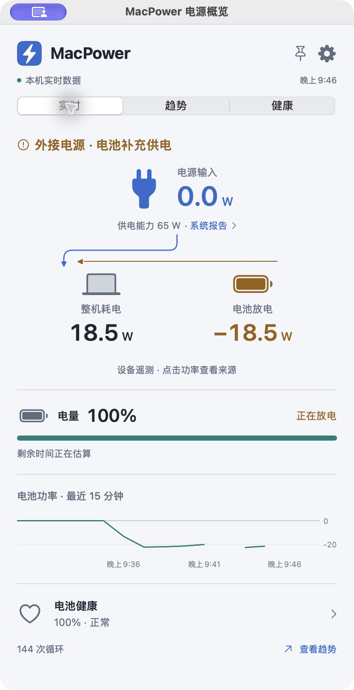
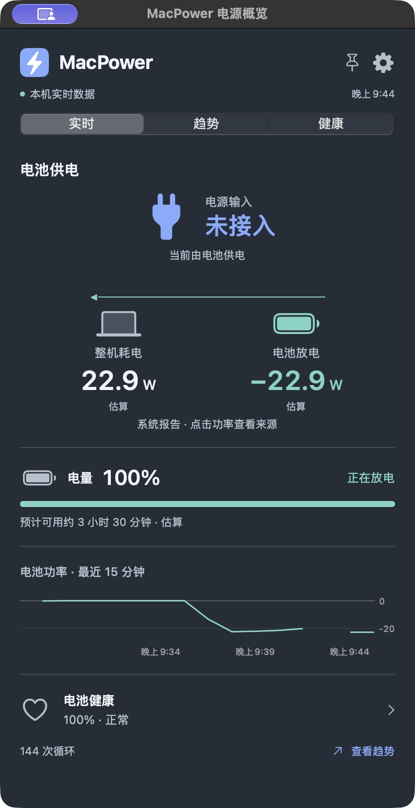

# MacPower

看懂 Mac 的供电、电池充放电与整机耗电。

MacPower 是一款原生 macOS 菜单栏工具，让你随时查看电脑正在消耗多少电、充电器实际输入多少功率，以及电池正在充电还是放电。点击菜单栏即可查看概览、历史趋势和电池健康。

## 主要功能

- **实时功率**：分别显示电源输入、电池净功率和整机耗电，区分适配器供电能力与实际输入。
- **菜单栏显示**：可选择整机耗电、电池净功率、电源输入或电量；电池图标按真实电量填充，并显示充电状态。
- **能源模式**：图标和数字随系统能源模式变色，节能绿色、自动蓝色、高性能橙色。
- **历史趋势**：查看功率、电量和用电变化，支持导出 CSV。
- **电池健康**：查看健康度、容量与循环次数。
- **外观与提醒**：支持浅色、深色和跟随系统，可按需开启电量提醒与登录启动。

## 界面预览

| 浅色 · 插电补充供电 | 深色 · 电池供电 |
|---|---|
|  |  |

## 安装和更新

适用于 **Apple Silicon Mac（M1 及更新芯片）**，需要 **macOS 14 或更新版本**。

在终端运行下面一条命令，无需下载源码、安装 Homebrew 或 Xcode：

```sh
curl -fsSL https://raw.githubusercontent.com/Linjay/MacPower/main/scripts/install.sh | zsh
```

首次运行安装 MacPower，以后再次运行同一命令即可更新。命令会自动下载最新发布（包含预览版）、校验文件、退出旧版并完成替换和启动，保留历史与设置；已安装相同或更新版本时会跳过替换，安装或启动失败时恢复旧版。

首次安装默认使用“应用程序”；如果该目录不可写，会使用个人的 Applications 目录。后续更新沿用已有安装位置。也可在 [GitHub Releases](https://github.com/Linjay/MacPower/releases) 查看版本说明和手动下载。

当前发布为预览版，尚未完成 Apple 公证。首次打开如被 macOS 阻止，请按系统提示在“系统设置 → 隐私与安全性”中为 MacPower 授权。

## 使用

点击菜单栏的功率数字打开面板，点击齿轮进入设置。右键菜单可打开独立概览窗口、检查更新或退出；关闭窗口后仍在菜单栏运行。

菜单栏默认显示整机耗电，可在设置中切换显示指标。鼠标悬停可查看指标名称、来源和能源模式。

电池净功率为正表示充电，为负表示电池向电脑供电。无法读取的指标显示为不可用，推算的数据带有估算标记。

## 隐私与控制

功率历史仅保存在本机的 `~/Library/Application Support/MacPower/`，不会上传。版本检查只读取 GitHub 的公开发布信息，不发送功率记录或硬件标识。

MacPower 只监测功率与电池状态，不控制充电，也不修改系统能源模式。通知、登录启动和自动检查更新默认关闭，由你选择开启。
